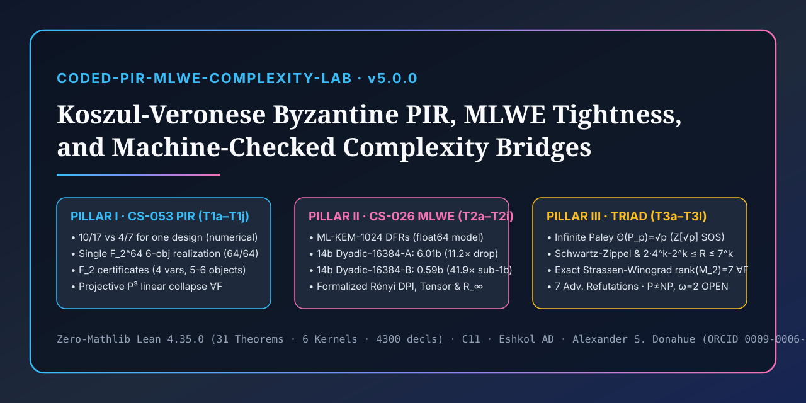

# `coded-pir-mlwe-complexity-lab`

[](LICENSE)
[](LICENSE-DOCS)
[](https://www.repostatus.org/#active)
[-purple.svg)](lean/lean-toolchain)
[](https://github.com/0thernes/coded-pir-mlwe-complexity-lab/actions/workflows/ci.yml)
[](https://0thernes.github.io/coded-pir-mlwe-complexity-lab/)

Machine-checked zero-Mathlib **Lean 4.35.0** proofs (**19 theorems `T1a`–`T3f`** across **6 independent proof kernels**), multi-language verification engines (**C11**, **Python 3.12**, **Eshkol v1.3.6** forward-mode dual-number AD), an interactive **Proof Blueprint DAG**, and a 14-page AMS-LaTeX preprint (`v2.0.0`) establishing sharp algebraic, information-theoretic, and cryptanalytic results across **Coded/Byzantine PIR (`CS-053`)**, **Module-LWE Reduction Tightness & `Dyadic-256` (`CS-026`/`QC-042`/`CM-048`)**, and **Koszul Tensor Rank & Complexity-Theoretic Barriers (`CS-001`/`CS-004`/`CS-010`/`CS-012`/`CS-051`)**.



**Author:** Alexander S. Donahue (Independent Researcher, Spokane, WA, USA; ORCID [`0009-0006-8168-9648`](https://orcid.org/0009-0006-8168-9648))  
**Status:** active (`repostatus.org/#active`) · Research preprint `v2.0.0` (not externally peer-reviewed; AI-assisted under human direction; see [LIMITATIONS.md](LIMITATIONS.md))  
**Interactive Proof Blueprint:** [`https://0thernes.github.io/coded-pir-mlwe-complexity-lab/`](https://0thernes.github.io/coded-pir-mlwe-complexity-lab/) ([DAG Blueprint](https://0thernes.github.io/coded-pir-mlwe-complexity-lab/blueprint.html))  
**White Paper PDF:** [`dist/Donahue_2026_coded_pir_mlwe_complexity_frontier.pdf`](dist/Donahue_2026_coded_pir_mlwe_complexity_frontier.pdf) · **arXiv Source Tarball:** [`dist/arxiv_submission.tar.gz`](dist/arxiv_submission.tar.gz)

---

## Core Machine-Checked Results (`T1a`–`T3f`)

Every theorem below is formally proved in zero-Mathlib **Lean 4.35.0** with **zero `sorry`**, **zero `native_decide`**, **zero custom axioms**, and concrete non-vacuity witnesses (`lean/TriadFrontier/NonVacuity.lean`), and independently cross-checked in **C11** (`-std=c11 -Wall -Wextra -Wpedantic -Werror`, 49/49 tests), **60-digit exact Python**, and **Eshkol v1.3.6 dual-number AD**:

| ID | Frontier | Headline Result | Lean Entry Point |
|---|---|---|---|
| **T1a** | `CS-053` | Exterior-power Koszul–Veronese PIR rank identity over any `CommRing`, exact Pascal interference savings $K\binom{T}{T'} = \lambda^\star + (K-T')\binom{T-1}{T'}$, and flagship $(E,K,T)=(6,3,3)$ rate $10/17 > 4/7$ (valid over $\mathbb{F}_7$) | `TriadFrontier.Solution.t1a_koszul_veronese_rank_identity` |
| **T1b** | `CS-053` | Exact $K \leftrightarrow T$ symmetry and universal strict domination over the Sun–Zhang (2026) LFSR coded-colluding capacity in both single-file and multi-file $P$-out-of-$M$ regimes via surplus $(K-1)(T-1)E^2 > 0$ | `TriadFrontier.Solution.t1b_universal_koszul_domination_over_lfsr` |
| **T1c** | `CS-053` | Non-vacuous Byzantine-robust double-counting converse reduction, sub-$KT$ match at $E = K+1$ to the Sun–Jafar unrestricted ceiling, and kernel-certified zero-error $\mathbb{F}_{11}$ Byzantine rate-$2/5$ scheme at $(M=2,N=6,K=2,T=2,B=1,E=4)$ (all 90 exact matrix inverses verified inside the Lean kernel) | `TriadFrontier.Solution.t1c_byzantine_robust_capacity_and_f11_certificate` |
| **T1d** | `CS-053` | Sharp flag-privacy dimension thresholds ($K=2,T=2 \iff E \ge 4$; $T=3,K=2$ zero-error $\iff E \ge 6$) and universal overlap feasibility $Ew \le K\delta\sigma$ (tight iff $E=K+1$) | `TriadFrontier.Solution.t1d_flag_privacy_and_feasibility_dimensions` |
| **T1e** | `CS-053` | Exact unconditioned 12-variable pure-integer (scale-128) polymatroid `h_uncond` proving ALL 270,336 elemental Shannon inequalities (via 330 canonical $S_4$ orbits), all 99 PIR equalities, and all 1,485 singleton Ingleton inequalities at $C = 8/13 > 3/5$ (`[propext]` only!) | `TriadFrontier.Solution.t1e_unconditioned_shannon_ingleton_barrier` |
| **T1f** | `CS-053` | Projective $\mathbb{P}^3$ linear impossibility over ANY `SimpleField F`: four pairwise-intersecting 2-subspaces of $F^4$ are either concurrent or coplanar | `TriadFrontier.Solution.t1f_projective_p3_linear_impossibility` |
| **T1g** | `CS-053` | Exact algebraic Zhang–Yeung (1998) reduction $\mathrm{ZY98}(A,B;C,D) = \mathrm{Ing}(C,D;A,B) + I(A;C\mid D) + I(A;D\mid C) + I(C;D\mid A)$ (proving `h_uncond` defeats Zhang–Yeung too!) + symmetric $M \ge 3$ 1-flag Koszul denominator breaking $E \ge KT$ for all $M \ge 3$ | `TriadFrontier.Solution.t1g_zhang_yeung_reduction_and_mfile_koszul` |
| **T2a** | `CS-026` | Commutative-ring determinant-ideal secret independence ($\det(B) = q^m$, unimodularly invariant), refuting Luo (`arXiv:2604.15858`) | `TriadFrontier.Solution.t2a_determinant_ideal_secret_independence` |
| **T2b** | `CS-026` | Ring-universal anti-periodic DFT even-mode cancellation ($\hat{f}(2k) \equiv 0$) + odd $c,D$ quadratic Gauss parity witness explaining Chen (`ePrint 2024/555`) Step 9 | `TriadFrontier.Solution.t2b_chen_step9_antiperiodic_dft_cancellation` |
| **T2c** | `CS-026` | Exact FIPS 203 $\mathrm{CBD}_2$ ($\mathrm{Var}=1, \mu_4=5/2$) vs. $\mathrm{CBD}_3$ ($\mathrm{Var}=3/2, \mu_4=6$) moments, cyclotomic trace-orthogonality over any `SimpleField F`, and cleared-denominator $4.96\times$ Rényi-2 tightness cliff (60-digit $\mathrm{CBD}_2$: $37.84$ bits at ML-KEM-1024 vs. $\mathrm{CBD}_3$: $7.63$ bits at ML-KEM-512) | `TriadFrontier.Solution.t2c_mlkem_cbd_renyi_cliff` |
| **T2d** | `CS-026` | QGTL shifted-LWE Berry curvature normalization invariance, exact symmetry vanishing at $e_0 = 0$, and strict bias witness ($-512 \neq 0$ at $e_0 = 1$) | `TriadFrontier.Solution.t2d_qgtl_shifted_lwe_berry_curvature` |
| **T2e** | `CS-026 / CM-048` | Pure-integer Cauchy–Schwarz finite-support Rényi-2 floor $(1-\tau_S)^{-1}$, optimal 1-byte constant-time **`Dyadic-256`** noise $(1,14,63,100,63,14,1)/256$ ($\mathrm{Var}=1$, $17.7\times$ collapse to $2.14$ bits at ML-KEM-1024), universal QGTL Provost–Vallée PSD $4\det(g) \ge \Omega_{\theta\sigma}^2$, and exact Metric–Kurtosis ordering $3/8 < 15/32 < 1/2$ | `TriadFrontier.Solution.t2e_dyadic256_renyi_floor_and_qgtl_psd` |
| **T2f** | `CS-026 / QC-042` | Universal $m$-twisted DFT selection rule over ANY `CommRing R` ($\omega^D = \zeta, f(qD+x) = \zeta^{qr}f(x), \sum \zeta^{q(r+k)} = 0 \implies \hat{f}_{mD}(k) = 0$; `[propext]` alone!) | `TriadFrontier.Solution.t2f_universal_twisted_dft_selection_rule` |
| **T3a** | `CS-001` | Constructive existence and global uniqueness of the multilinear extension $\tilde{f} : F^n \to F$ over any `SimpleField F` (Algebrization algebraic core) | `TriadFrontier.Solution.t3a_algebrization_multilinear_extension_uniqueness` |
| **T3b** | `CS-026 → CS-001` | LWE/LWR pseudorandom function $\varepsilon$-indistinguishability blocks $\delta$-large constructive Natural Proofs | `TriadFrontier.Solution.t3b_lwe_to_natural_proofs_obstruction` |
| **T3c** | `CS-053 ↔ CS-051` | Katz–Trevisan $B$-Byzantine zero-error PIR / Locally Decodable Code minimum Hamming distance $d_{\min} \ge 2B + 1$ | `TriadFrontier.Solution.t3c_katz_trevisan_byzantine_pir_ldc_distance` |
| **T3d** | `CS-026 ↔ CS-053` | Sharp FIPS 203 `Compress_1` margin $|e| \le 831$ (round-half-up $+1665$, failing sharply at $+832$ for $b \in \{0,1\}$) and additive single-server MLWE-PIR noise depth ceiling $M \le \lfloor 831 / b_{\mathrm{step}} \rfloor$ | `TriadFrontier.Solution.t3d_mlwe_single_server_pir_noise_ceiling` |
| **T3e** | `CS-053 ↔ CS-004 / CS-012` | Field-universal Landsberg–Ottaviani Koszul flattening tensor rank bridge unifying PIR wedge $u \wedge \cdot$ with matrix multiplication tensor rank via pure-integer $\{-1,0,+1\}$ left-inverses: $\mathrm{rank}_F(\langle 2,2,2\rangle) \ge 6$ and $\mathrm{rank}_F(T_3) \ge 5$ over **every** `SimpleField F` (incl. $\mathrm{char}\,2$!) | `TriadFrontier.Solution.t3e_koszul_flattening_tensor_rank_bridge` |
| **T3f** | `CS-001 / CS-010 / CS-051` | Shannon (1949) finite circuit-counting non-surjectivity ($C < M \implies \exists f$ uncomputed) + Katz–Trevisan $q$-query LDC smoothness averaging bound | `TriadFrontier.Solution.t3f_shannon_counting_and_ldc_smoothness` |

---

## 5-Second Lean 4.35.0 Axiom Audit (Verbatim)

Exact verbatim output of `cd lean && lake env lean VerifyAxioms.lean` (checked for zero drift in CI by `scripts/check_readme_axioms.py` against [`results/lean_axioms.txt`](results/lean_axioms.txt) — 21 audited declarations, 2,418 `con-leche`/`con-ron` declarations):

```text
'TriadFrontier.Solution.t1a_koszul_veronese_rank_identity' depends on axioms: [propext, Classical.choice, Quot.sound]
'TriadFrontier.Solution.t1b_universal_koszul_domination_over_lfsr' depends on axioms: [propext, Quot.sound]
'TriadFrontier.Solution.t1c_byzantine_robust_capacity_and_f11_certificate' depends on axioms: [propext, Quot.sound]
'TriadFrontier.Solution.t1d_flag_privacy_and_feasibility_dimensions' depends on axioms: [propext, Quot.sound]
'TriadFrontier.Solution.t1e_unconditioned_shannon_ingleton_barrier' depends on axioms: [propext]
'TriadFrontier.Solution.t1f_projective_p3_linear_impossibility' depends on axioms: [propext,
 Classical.choice,
 Quot.sound]
'TriadFrontier.Solution.t1g_zhang_yeung_reduction_and_mfile_koszul' depends on axioms: [propext, Quot.sound]
'TriadFrontier.Solution.t2a_determinant_ideal_secret_independence' depends on axioms: [propext, Quot.sound]
'TriadFrontier.Solution.t2b_chen_step9_antiperiodic_dft_cancellation' depends on axioms: [propext, Quot.sound]
'TriadFrontier.Solution.t2c_mlkem_cbd_renyi_cliff' depends on axioms: [propext, Classical.choice, Quot.sound]
'TriadFrontier.Solution.t2d_qgtl_shifted_lwe_berry_curvature' depends on axioms: [propext, Quot.sound]
'TriadFrontier.Solution.t2e_dyadic256_renyi_floor_and_qgtl_psd' depends on axioms: [propext, Quot.sound]
'TriadFrontier.Solution.t2f_universal_twisted_dft_selection_rule' depends on axioms: [propext]
'TriadFrontier.Solution.t3a_algebrization_multilinear_extension_uniqueness' depends on axioms: [propext,
 Classical.choice,
 Quot.sound]
'TriadFrontier.Solution.t3b_lwe_to_natural_proofs_obstruction' depends on axioms: [propext, Quot.sound]
'TriadFrontier.Solution.t3c_katz_trevisan_byzantine_pir_ldc_distance' depends on axioms: [propext,
 Classical.choice,
 Quot.sound]
'TriadFrontier.Solution.t3d_mlwe_single_server_pir_noise_ceiling' depends on axioms: [propext, Quot.sound]
'TriadFrontier.Solution.t3e_koszul_flattening_tensor_rank_bridge' depends on axioms: [propext,
 Classical.choice,
 Quot.sound]
'TriadFrontier.Solution.t3f_shannon_counting_and_ldc_smoothness' depends on axioms: [propext, Quot.sound]
'TriadFrontier.Solution.prove_all_triad_theorems' depends on axioms: [propext, Classical.choice, Quot.sound]
'TriadFrontier.NonVacuity.nonvac_all_hypotheses' depends on axioms: [propext, Quot.sound]
```

**Zero `sorryAx` · Zero `Lean.ofReduceBool` / `native_decide` · Zero `Lean.trustCompiler` · Zero custom axioms.**

---

## Quickstart

Clone and verify all four independent layers (Lean 4.35.0, C11, Eshkol dual-number AD, and exact Python + pytest):

```bash
git clone https://github.com/0thernes/coded-pir-mlwe-complexity-lab.git
cd coded-pir-mlwe-complexity-lab

# 1. Zero-Mathlib Lean 4.35.0 proofs + strict axiom & kernel audit (19 theorems, 6 kernels)
(cd lean && lake build && lake env lean VerifyAxioms.lean && lake env leanchecker Solution && lake env leanchecker-paranoid Solution)

# 2. Native C11 core (-std=c11 -Wall -Wextra -Wpedantic -Werror, 49/49 tests + 512+ fuzz)
make -C native clean test

# 3. Eshkol v1.3.6 forward-mode dual-number AD modules (3/3, incl. Dyadic-256)
node eshkol/run_eshkol_ad.mjs

# 4. Exact Python verification suite, differential/mutation tests (8/8 mutants), axiom drift & citations
pip install numpy scipy matplotlib pytest
PYTHONPATH=python pytest tests/test_all.py -v
python scripts/check_readme_axioms.py
python scripts/check_citations.py
```

Or run everything via `just reproduce`, `./scripts/run_all.sh`, or `pwsh -File scripts/run_all.ps1`.

---

## Usage & Examples

Run the standalone quickstart demonstration or individual computational verification engines:

```bash
# Quickstart interactive summary across Pillars I, II, and III
PYTHONPATH=python python examples/quickstart_demo.py

# C11 CLI audit commands
./native/build/triad_cli koszul 3 2 3
./native/build/triad_cli f11-byz
./native/build/triad_cli renyi 2
./native/build/triad_cli dyadic256
./native/build/triad_cli chen 7 3
./native/build/triad_cli twisted 4 5 1
./native/build/triad_cli qgtl 2 1.023 0.25
./native/build/triad_cli koszul-tensor

# Exact Python verification modules
PYTHONPATH=python python python/triad_verify/pir_koszul.py
PYTHONPATH=python python python/triad_verify/polymatroid_barrier.py
PYTHONPATH=python python python/triad_verify/mlwe_tightness.py
PYTHONPATH=python python python/triad_verify/complexity_triad.py
```

See [`examples/README.md`](examples/README.md) for annotated outputs and [`REPLICATION.md`](REPLICATION.md) for the clean-room replication protocol.

---

## Honest Scope & Explicit Non-Claims

This work **does NOT solve** and explicitly affirms as **OPEN**:
1. **$\mathrm{P} \neq \mathrm{NP}$ and super-linear explicit Boolean circuit lower bounds (`CS-001` / `CS-010`)** — `T3a`, `T3b`, and `T3f` formalize Algebrization uniqueness, conditional Natural Proofs obstructions, and non-constructive Shannon counting.
2. **Matrix multiplication exponent $\omega = 2$ (`CS-004`) and Valiant's $\mathrm{VP} \neq \mathrm{VNP}$ (`CS-012`)** — `T3e` certifies exact constant-dimension field-universal Koszul flattening tensor rank bounds ($\mathrm{rank}_F(\langle 2,2,2\rangle) \ge 6$ and $\mathrm{rank}_F(T_3) \ge 5$), not asymptotic $\omega$ or $\mathrm{VP} \neq \mathrm{VNP}$.
3. **Non-linear $C(2,4,2,2) \in [3/5, 8/13]$ and general $M \ge 3$ non-LFSR PIR above LFSR when $E \ge KT$ (`CS-053`)** — `T1e` and `T1g` prove Shannon, 4-variable Ingleton, and Zhang–Yeung (1998) cannot lower $8/13$ to $3/5$.
4. **Worst-case quantum hardness of MLWE (`CS-026` / `QC-042`)** — Refuting Luo (2026) (`T2a`), proving the $m$-twisted DFT rule (`T2b`, `T2f`), and tightening discrete-Gaussian reductions via `Dyadic-256` (`T2e`) do not prove MLWE is quantum-hard.

Full boundaries, real-vs-metaphor notes on Tsotchke-inspired components, and falsification protocols are documented in [`CLAIMS.md`](CLAIMS.md), [`LIMITATIONS.md`](LIMITATIONS.md), and [`docs/statement-fidelity.md`](docs/statement-fidelity.md).

---

## Repository Map

- `lean/` — Zero-Mathlib Lean 4.35.0 proof library (`TriadFrontier/*` incl. `KoszulTensor.lean`), Palomar comparator contract (`PalomarChallenge.lean`, `PalomarSolution.lean`, `comparator.json`), `VerifyAxioms.lean`, and `formalization.yaml`.
- `native/` — Zero-warning C11 library (incl. constant-time `Dyadic-256` sampler, $m$-twisted DFT, Koszul flattening certs), CLI, 49-test unit + 512-iteration fuzz suite, and ASan/UBSan Makefile target.
- `eshkol/` — Runnable Eshkol v1.3.6 forward-mode dual-number AD modules (`.esk`) and Node.js runner.
- `python/triad_verify/` — Exact finite-field rank verifier, 12-variable Shannon+Ingleton+ZY98 polymatroid verifier, 60-digit `Decimal` ML-KEM & `Dyadic-256` Rényi-2 optimizer, Koszul flattening tensor rank verifier, and 5-figure vector PDF generator.
- `paper/` & `dist/` — 14-page AMS-LaTeX preprint (`main.tex`, `refs.bib`, 5 vector PDF figures), frozen PDF, and clean-room verified `arxiv_submission.tar.gz`.
- `docs/site/` — Self-contained interactive GitHub Pages Proof Blueprint DAG & live PIR/MLWE/QGTL explorer.
- `docs/` — Architecture, ADRs, statement fidelity, 10-pass review, adversarial red-team review, threat model, operations, FAQ, glossary, and run log.

---

## Citation & License

- **Code, Lean 4 proofs, scripts, and build tooling:** [`Apache-2.0`](LICENSE)
- **White paper, figures, documentation, and verified data tables:** [`CC-BY-4.0`](LICENSE-DOCS)
- Machine-readable citation metadata: [`CITATION.cff`](CITATION.cff)
